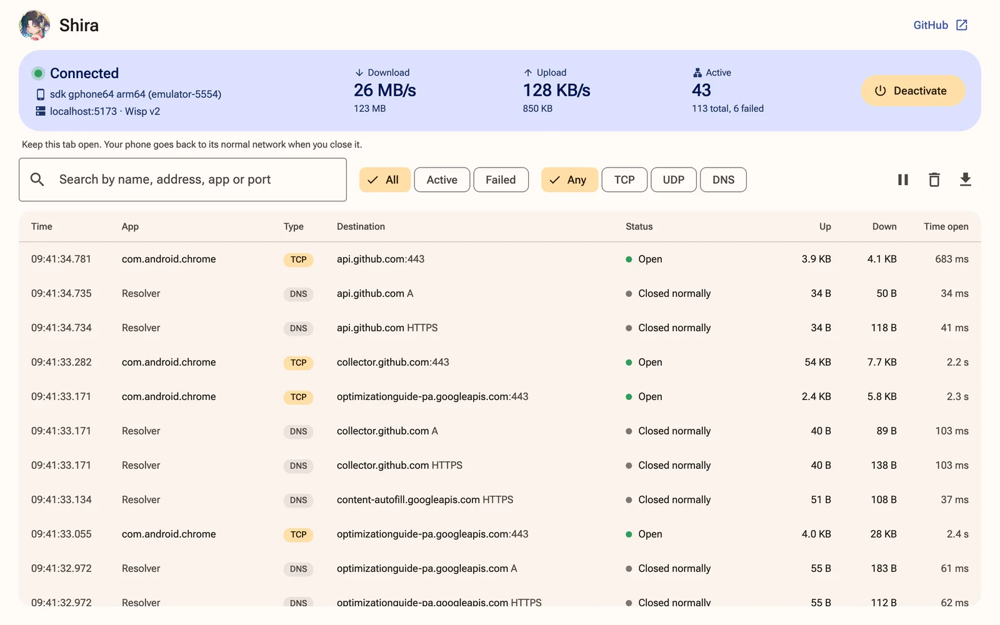

<p align="center">
  
</p>

<h1 align="center">Shira</h1>

<p align="center">Get your phone online through a browser tab.</p>

<p align="center">
  <a href="https://github.com/wonderhoy-labs/shira/actions/workflows/ci.yml"></a>
  <a href="LICENSE"></a>
  <a href="#license-and-credits"></a>
</p>

Shira gives an Android phone a network connection through a web page on a computer, over a USB cable. It works with the phone's
Wi-Fi and mobile data turned off, and the computer needs nothing but Chrome.

You open the page, plug in your phone and enter a [Wisp](https://github.com/MercuryWorkshop/wisp-protocol) server. The page can
install and start the app for you. After that, everything on the phone goes down the cable to the browser tab and out through
the Wisp server, and the page shows you every connection as it happens: which app made it, where it went, and how much it sent.

There's no root on the phone, and no `adb`, drivers or anything else on the computer.



> **This is early.** We've only tested it on one Pixel 10 Pro running Android 17 and on an Android 17 emulator, with Chrome on a
> Mac. [Here's exactly what that covers.](#what-has-been-tested) If you try anything else, please
> [open an issue](https://github.com/wonderhoy-labs/shira/issues) and tell us how it went, even if it just worked.

## What you need

- An Android 10 or newer phone with **USB debugging** turned on in Developer options.
- A USB cable that carries data.
- A computer with Chrome, Edge or another Chromium browser. Safari and Firefox don't have WebUSB.
- A Wisp server. [Here's what to look for.](#wisp-servers)

## Use it

1. Open **<https://wonderhoy-labs.github.io/shira/>** and click **Connect phone**. Pick your phone from the list, then unlock it
   and tap **Allow** if it asks about USB debugging.
2. Install the app. **Install it for me** does it through USB debugging. **I'll install it myself** gives you the APK and waits
   until it sees the app on your phone. You can also get it from
   [Releases](https://github.com/wonderhoy-labs/shira/releases).
3. Enter your Wisp server's address, like `wss://example.com/wisp/`. If it needs a login, the page asks for one.
4. Activate it. **Activate it for me** does everything through USB debugging, with nothing to tap. **I'll activate it on my
   phone** waits for you to open Shira and tap **Activate**, and Android asks for your OK the first time.

That's it. Your phone's online, and the connections appear in the log. Turn on airplane mode if you want to see it working with
nothing else underneath.

Keep the tab open. It's what carries the traffic, so it's fine in the background, but closing it takes your phone offline. Your
phone goes back to its normal network within 10 seconds, and Shira waits on the phone in case you come back.

If the cable comes out, plug it back in and the page carries on by itself. Connections that were open are lost, and apps make
new ones. The same goes for the Wisp server: if it drops, your phone's normal network is back until the page reconnects.

To stop, click **Deactivate** on the page, in the app or in its notification.

### The log

Every connection gets a row, newest first, with the app's package, the destination, its status, and how much went each way.
Click one for the details, including the address behind the name and Wisp's reason for closing it. You can search by name,
address, app or port, filter by protocol or by what's active or failed, pause the display, and save the whole log as JSON.

DNS lookups get their own rows. Names come from the phone's own resolver, which remembers which name each address was an answer
for. An app that does its own secure DNS shows up with addresses, because the resolver never sees its questions.

The log only exists in that tab. It's never sent anywhere, and it's gone when you close it. It keeps the latest 20,000 rows.

## Use it in your app

Shira is two libraries, and its own page and app are built on them.

**`@wonderhoy-labs/shira`** gives any web page Shira's whole job: it installs the app it carries, waits for the VPN,
relays every connection through a Wisp server, keeps going when the server drops, and writes each connection to a log.
[Asahi](https://github.com/wonderhoy-labs/asahi) uses it. Add a release by its address:

```json
"@wonderhoy-labs/shira": "https://github.com/wonderhoy-labs/shira/releases/download/v0.3.0/wonderhoy-labs-shira-0.3.0.tgz"
```

Bring an `Adb` from [Tango](https://github.com/yume-chan/ya-webadb), over WebUSB or the `adb` server:

```ts
import { LogStore, normalizeServerUrl, Phone, ShiraLink } from "@wonderhoy-labs/shira";
import apkUrl from "@wonderhoy-labs/shira/shira.apk?url";

const phone = new Phone(adb, "My phone", "usb");
if (!(await phone.appInfo()).installed) {
	await phone.install(new Uint8Array(await (await fetch(apkUrl)).arrayBuffer()), () => undefined);
}
const server = normalizeServerUrl("wss://wisp.example/");
if ("problem" in server) throw new Error(server.problem);
const link = new ShiraLink({
	phone,
	serverUrl: server.url,
	credentials: null,
	log: new LogStore(),
	events: {
		onState: (state) => console.log(state),
		onStopped: (reason) => console.log("stopped", reason),
	},
});
link.start("auto");
```

| Export | What it does |
| --- | --- |
| `ShiraLink` | Waits for the VPN, relays through Wisp, reconnects, and says why it stopped |
| `Phone` | The app on the phone: its version, installing it, starting the VPN and opening its socket |
| `LogStore`, `format…`, `describe…` | Every connection, with its app, bytes and how it ended, and words for them |
| `connectWisp`, `normalizeServerUrl` | Checking a Wisp server, with or without a login |
| `Upstream`, `UpstreamConnector`, `wispUpstream` | Where the phone's connections go, for sending them somewhere other than a Wisp server |

A Wisp server is only the default. Pass `upstream` instead of `serverUrl` to send the phone's connections anywhere
else: an `UpstreamConnector` makes `Upstream`s, which open a TCP or UDP stream for each of the phone's connections and
say how many packets each can take, as Wisp's CONTINUE does. [Shiho](https://github.com/wonderhoy-labs/shiho) uses it
to open them itself from the computer with Direct Sockets.

It needs a bundler that understands `?url`, such as Vite, and a phone that allows USB debugging. It runs on wisp-js
from Wonderhoy Labs' fork, which pnpm won't fetch from git for a dependency's dependency, so add it next to the library,
pinned as in [`packages/shira/package.json`](packages/shira/package.json):

```json
"@mercuryworkshop/wisp-js": "github:wonderhoy-labs/wisp-js#960fa6b995d3b210d77fd81e99435aa7cf555721"
```

**`shira-tunnel`** is the app's network stack for Android: TCP, UDP and DNS ended in Kotlin from a TUN device's
packets, and the framing that carries them over a socket, with nothing else from Android. Each release has it as
`shira-tunnel-<version>.aar`. Add the Wonderhoy Labs repository from
[the library notes](.claude/skills/wonderhoy-unification/reference/library.md#android-libraries), then:

```kotlin
implementation("shira:tunnel:0.3.0@aar")
```

`Tunnel` takes packets from the device with `onAppPacket` and frames from the socket with `onPagePacket`, and
writes back through the `AppPort` and `PagePort` you give it. `Link` makes and reads the frames. It needs only the
Kotlin standard library.

## Wisp servers

A Wisp server turns a WebSocket into TCP and UDP connections. All your phone's traffic goes through it, so use one you run
yourself or trust. [wisp-js](https://github.com/MercuryWorkshop/wisp-js) and
[epoxy-server](https://github.com/MercuryWorkshop/epoxy-tls) are two you can host.

From a site served over HTTPS, as the official page is, the browser only allows `wss://` addresses, apart from `ws://localhost`.

Shira needs these from a server:

- **Connections to IP addresses.** The phone asks 1.1.1.1 for addresses, and apps connect to those. A server with
  `allow_direct_ip` turned off, as wisp-js calls it, refuses everything.
- **TCP to port 53 on 1.1.1.1**, for DNS.
- **UDP, if you want it.** Without it, apps that try QUIC are told straight away that it won't work, and they fall back to TCP.

It speaks Wisp version 2, and falls back to version 1 for servers that only have that. It shows a server's welcome message if it
has one. For logins it does the password extension, which it only ever sends to a server that asked for it. The password stays in
the tab's memory, so you enter it again after a reload. Key-based logins aren't supported yet, because wisp-js doesn't have them.
To require a login you need a server that checks it, like epoxy-server, because wisp-js's server doesn't.

> **If you host wisp-js:** in the npm release, when a destination closes a connection, the server throws away whatever it hasn't
> sent on yet, so a fast download can get cut short with no error. It only shows when the destination is faster than your link to
> the server. The `fixes` branch of [our fork](https://github.com/wonderhoy-labs/wisp-js/tree/fixes) fixes that, and epoxy-server
> is another way around it.

## What has been tested

All of this is with Chrome on a Mac.

**On a Pixel 10 Pro running Android 17,** with a production build: connecting over WebUSB, installing the release APK, activating
it and getting online through a Wisp server on the same Mac.

**On an Android 17 emulator,** through the development server's link to `adb`, because an emulator has no USB. Wi-Fi and mobile
data were off. Chrome loaded Wikipedia and YouTube, and DNS, TCP and QUIC all showed up in the log. 200 MiB went each way intact,
at about 420 Mbit/s down and 390 Mbit/s up. Those numbers are for that path, not USB. Also working:

- both ways to install, updating, and recovering from a copy signed with another key
- both ways to activate, including Android's own dialog
- password logins: missing, wrong and right
- a stock wisp-js server, its welcome message, and losing it and getting it back
- turning Shira off from the page and from the app, closing the tab, and a page that goes silent
- turning Shira off from the page in Chrome 156 while Chrome on the emulator was loading Wikipedia, five times in a row. Before the
  page closed the Wisp connection in a task of its own, this crashed the tab every time. Force-stopping the app during a page load
  didn't crash it, with or without that change.
- another page taking over
- keeping other apps out: Android refused another app's connection to the socket, the app refused one from its own user ID, and
  Android refused another app opening the name that turns it on

**Shira 0.3.0's upstreams,** on the same emulator with Wi-Fi and data off: Shira's own page through its development
Wisp server (Wisp v2, DNS and TCP from Google Play services), and [Shiho](https://github.com/wonderhoy-labs/shiho)'s Direct
Sockets upstream from an Isolated Web App in Chrome for Testing 156 (Chrome on the emulator over TCP and QUIC). The app didn't
change in 0.3.0.

**Not tried yet:** speed over real USB, replugging the cable, turning Shira off over WebUSB while apps have connections open,
other phones, Windows, Linux, Edge, epoxy-server, a server that only speaks Wisp version 1, and a Private DNS provider set by
hostname. Password logins have only run against the development server, which checks them the way the protocol
describes.

## How it works

```
   apps on the phone
          │  IP packets
          ▼
     VPN device            ┐
          │                │  the Shira app: TCP, UDP and DNS end here
   TCP, UDP and DNS        ┘
          │  Wisp packets, each with its length in front
          ▼
 adb socket on the phone
          │  USB
          ▼
    browser (WebUSB)       ┐
          │                │  the web page: Tango for adb, wisp-js for Wisp
    relay and the log      ┘
          │  WebSocket
          ▼
     Wisp server
          │
          ▼
    the internet
```

Normal apps can't use a phone's USB port as a network. What they can do is be a VPN, which is an app that receives every packet
the phone sends. Shira's app does that, and ends the connections right there. It's a small TCP stack in Kotlin that acts as the
other end of every connection an app makes, and turns each one into a Wisp stream. There's no raw IP past that point, so the
browser only sees streams, and apps get their ACKs straight away.

The page reaches the app through `adb`, which is why USB debugging has to be on. [Tango](https://github.com/yume-chan/ya-webadb)
speaks `adb` over WebUSB from the browser, and opens a socket that the app is listening on. The packets on that socket are
[Wisp's own](docs/protocol.md), with a length in front of each. The page hands them to
[wisp-js](https://github.com/MercuryWorkshop/wisp-js), which keeps the connection to your Wisp server.

Installing and activating go through `adb` too. Activating gives the app the same approval that Android's own VPN dialog would
have given it, then opens its screen.

The VPN only exists while the page is attached and connected to a Wisp server. If you turn Shira on and walk away, nothing happens
to your network until a page connects.

Android has to be told the VPN is a real network, or apps think they're offline when there's nothing else. Shira does what
[Akiyama](https://github.com/wonderhoy-labs/akiyama) does, and names the VPN as its own underlying network.

### DNS

Android is told to use a resolver at an address with nothing behind it, and the app picks those questions out of the packets. It
answers from a small cache if it can, and otherwise asks `1.1.1.1` through Wisp. Each question gets its own TCP stream, because
every Wisp server has TCP and only some have UDP.

Your phone's Private DNS setting still works. On **Automatic**, Android finds nothing at port 853 and uses Shira's resolver. With
a provider's hostname set, it looks that up through Shira and then talks to the provider directly, through Wisp.

### Only IPv4

The VPN only has an IPv4 side, and Android doesn't let IPv6 past a VPN that doesn't handle it. Wisp doesn't say when a connection
succeeds, so a connection looks fine to an app the moment it's made. An IPv6 attempt to a server with no IPv6 would look like it
worked and then fail, instead of falling back the way apps normally do. IPv6-only sites are unreachable for now.

## Security and privacy

Worth reading before you use this.

**The page has the same access as `adb`.** Code on it can do anything `adb` can on the phone you connect, so only use the address
above or a copy you host yourself. It runs nothing from elsewhere, and its content security policy keeps it that way. The key your
phone trusts stays in that browser's profile. To take that trust back, use **Revoke USB debugging authorizations** in Developer
options.

**The Wisp server carries everything.** It sees where your phone connects and anything that isn't encrypted, including your DNS
questions. HTTPS is still HTTPS. Shira adds no encryption of its own past the `wss://` to the server, and a `ws://` address has none
at all. Your login goes over that same connection.

**1.1.1.1 sees your DNS questions,** and the server sees them too, since it's plain DNS. There's no setting for this yet.

**Other apps on the phone are kept out.** The app has no INTERNET permission, so its only way out is the cable. Its socket takes
connections only from `adb`. On our emulator, Android itself refused another app, and the app checks who's calling as well. Only
`adb` can open the name that turns it on. Any app could listen on the socket's name first, so
the page waits until Shira's own service is running before it connects, and that service stops if it can't get the name.

**Activating for you is the same approval as the dialog.** It stays until you remove it, like any VPN's. You can do that by
uninstalling Shira. It also grants the notification permission, so that you can see it's running.

**It replaces any other VPN on the phone while it's on.** Android only runs one. The other one doesn't come back by itself, so turn
it back on when you're done.

## Troubleshooting

**Your phone isn't in the browser's list.** Check that USB debugging is on and that the cable carries data. The list only shows
devices with an `adb` connection.

**"Something else on this computer is using USB debugging".** Only one program can use it at a time. Close any WebADB tabs, quit
Android Studio, and stop `adb`, because other tools can start it again by themselves:

```bash
adb kill-server
```

**It stays on "Unlock your phone".** It's waiting for you to unlock the phone and allow USB debugging. If the prompt never comes,
unplug the cable and plug it in again.

**The app won't install.** Play Protect may ask about it, because it's not from the Play Store. The page tells you Android's reason
if it's anything else.

**"Signed with a different key".** You have a copy from somewhere else, like your own build. Remove it with the button on the page.

**It stays on "Starting Shira on your phone".** Unlock the phone, because a locked phone can't open the app. If it's asking about
a VPN connection, tap **OK**.

**"Android wouldn't start the VPN".** Another app is set as an always-on VPN. Turn that off in Settings, under Network & internet,
then VPN.

**Pages don't load, but the log shows connections failing.** Check the status of a few rows. "Blocked by the server" means it refuses
that address or port, and the [server's needs](#wisp-servers) above are a good place to start. If DNS rows fail, it can't reach
`1.1.1.1:53`.

**Your phone says it's offline after you close the tab.** Android may take a moment to go back to its normal network.

If you're reporting a bug, please include your phone model, Android build number, browser version and which Wisp server software
you're using. The JSON you can save from the log can help, but look through it first, because it lists everywhere your phone
connected.

## Known issues

- `ping` doesn't work, because Wisp only carries TCP and UDP. Apps that check connectivity by pinging may say they're offline.
- No IPv6, for the [reason above](#only-ipv4).
- An app's connection looks like it succeeded before the server has tried it. If the server then can't connect, the app sees the
  connection reset instead of refused, because Wisp doesn't confirm connections.
- Wisp has no half-close. When an app finishes sending but keeps reading, the stream stays open until the app finishes reading or
  everything goes quiet for 10 seconds. The destination doesn't find out the app is done sending, so a server that waits for that
  before it answers won't answer.
- An app that stops reading a download keeps its connection until the phone is holding 8 MiB for apps in total, and then loses it
  if it's still not reading 2 seconds later. Everything else waits for those 2 seconds. A paused video is the likely case, and video
  players reconnect by themselves.
- Traffic to your local network goes to the Wisp server too, which usually refuses it.
- Key-based Wisp logins aren't supported.

## Development

You need Node 24 or newer with pnpm, JDK 17 or newer, and the Android SDK with platform 37. On Windows, use `gradlew.bat`.

Shira follows the [Wonderhoy Labs guideline](.claude/skills/wonderhoy-unification/SKILL.md), like every Wonderhoy Labs project.
The shared tools need Node 24 or newer and pnpm. Format before you commit, and check the result:

```bash
pnpm install && pnpm format && pnpm unify
```

| Where | What's in it |
| --- | --- |
| `android/tunnel/` | The `shira-tunnel` library: the TCP, UDP and DNS side, and the messages on the socket, with nothing Android-specific so that it can be tested on its own |
| `android/app/src/main/kotlin/com/wonderhoylabs/shira/vpn/` | The service, and the thread that moves everything |
| `android/app/src/main/kotlin/com/wonderhoylabs/shira/ui/` | The app's screen |
| `packages/shira/` | The `@wonderhoy-labs/shira` library: the socket's messages, the relay to Wisp, the link, the log, and what's done on the phone |
| `web/src/adb/` | Reaching the phone over WebUSB or the `adb` server |
| `web/src/shira/controller.ts` | Everything the page does, step by step |
| `web/src/ui/` | The page's screens, using [mdui](https://github.com/zdhxiong/mdui) for Material 3 |
| `web/plugins/` | The Vite plugin: the APK, and the development servers |
| `VERSION` | The version, for both the app and the page |
| `tools/` | The shared Wonderhoy Labs tools: `theme.ts` makes the colours, `unify.ts` checks the guideline |

Build the app, then start the page:

```bash
cd android && ./gradlew :app:assembleDebug
```

```bash
pnpm install && cd web && pnpm dev
```

The development server does a few things production gets from elsewhere:

- **It runs a Wisp server** at `/wisp/` on the same port, and the page starts with that address filled in. It can reach this
  computer's own services too, so it only takes connections from this page. To try logins, set
  `SHIRA_DEV_WISP_AUTH=user:password` before you start it.
- **It serves the debug APK.** Set `SHIRA_APK` to a path to serve another.
- **It can reach `adb`.** Emulators don't appear over USB, so the page also lists whatever your `adb` server can see. That runs the
  real page against an emulator or a phone, with `adb` still available for looking around. WebUSB and `adb` can't share a phone, so
  this is also the easy way to test on one.

A production build needs a release APK, because the site carries it, and asks you for a Wisp server like the real one does. Preview
serves that build with the same Wisp server, at `ws://localhost:4173/wisp/`.

```bash
cd android && ./gradlew :app:assembleRelease
```

```bash
cd web && pnpm build && pnpm preview
```

Tests:

```bash
cd android && ./gradlew :app:testDebugUnitTest
```

```bash
cd web && pnpm test
```

`ScreenTest` draws every state of the app's screen and saves pictures. Run it on an emulator with `am instrument`, because Gradle's
connected task uninstalls the app, and its pictures with it:

```bash
cd android && ./gradlew :app:assembleDebug :app:assembleDebugAndroidTest
```

```bash
adb install -r app/build/outputs/apk/debug/app-debug.apk && adb install -r -t app/build/outputs/apk/androidTest/debug/app-debug-androidTest.apk
```

```bash
adb shell am instrument -w com.wonderhoylabs.shira.test/androidx.test.runner.AndroidJUnitRunner
```

The pictures end up in `/sdcard/Android/data/com.wonderhoylabs.shira/files/screens/`.

Release APKs are signed with your debug key unless you set `SHIRA_KEYSTORE`, `SHIRA_KEYSTORE_PASSWORD`, `SHIRA_KEY_ALIAS` and
`SHIRA_KEY_PASSWORD`.

Pushing to `main` builds everything through [ci.yml](.github/workflows/ci.yml) and publishes the site to GitHub Pages, whose source
has to be GitHub Actions. Pushing a tag like `v0.1.0`, matching `VERSION`, builds everything and publishes a GitHub release through
[ci.yml](.github/workflows/ci.yml). It signs the APK with the repository's `SHIRA_KEYSTORE_BASE64`, `SHIRA_KEYSTORE_PASSWORD`,
`SHIRA_KEY_ALIAS` and `SHIRA_KEY_PASSWORD` secrets. Without them, each release gets a throwaway key and has to be installed
fresh instead of updating.

## License and credits

Shira is a [Wonderhoy Labs](https://github.com/wonderhoy-labs) project, released under the [Apache License 2.0](LICENSE). It isn't
affiliated with Google. Android is a trademark of Google LLC.

It stands on the work of these projects:

- [wisp-js](https://github.com/MercuryWorkshop/wisp-js) and the [Wisp protocol](https://github.com/MercuryWorkshop/wisp-protocol), by
  Mercury Workshop. wisp-js is under the GNU LGPL 3.0 or later. The page and its development server use
  [our fork](https://github.com/wonderhoy-labs/wisp-js/tree/fixes), which is upstream with two fixes. To use another version, change
  it in `web/package.json` and rebuild.
- [Tango](https://github.com/yume-chan/ya-webadb) (MIT), by Simon Chan, for `adb` over WebUSB
- [mdui](https://github.com/zdhxiong/mdui) (MIT), for the page's Material 3 components
- [React](https://github.com/facebook/react) (MIT) and [TanStack Virtual](https://github.com/TanStack/virtual) (MIT)
- [Roboto Flex](https://github.com/googlefonts/roboto-flex) (OFL 1.1), through [Fontsource](https://github.com/fontsource/fontsource)
- [Jetpack Compose and AndroidX](https://developer.android.com/jetpack) (Apache 2.0), for the Android app
- [Material Color Utilities](https://github.com/material-foundation/material-color-utilities) (Apache 2.0), which makes the
  colours from the character's image colour

The site publishes everything it bundles, with license texts, as `third-party-licenses.txt`.

Shira is named for Shiraishi An of Vivid BAD SQUAD, from Project SEKAI COLORFUL STAGE! feat. Hatsune Miku. Wonderhoy Labs is a
fan project, not affiliated with SEGA, Colorful Palette or Crypton Future Media, who own Project SEKAI and its characters.
The Apache License doesn't cover the Shira name or logo.
